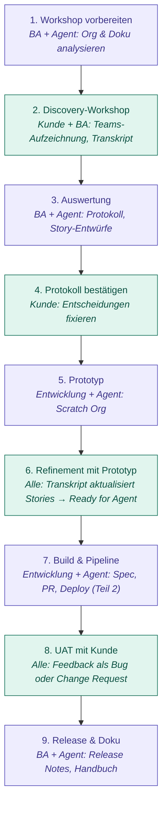
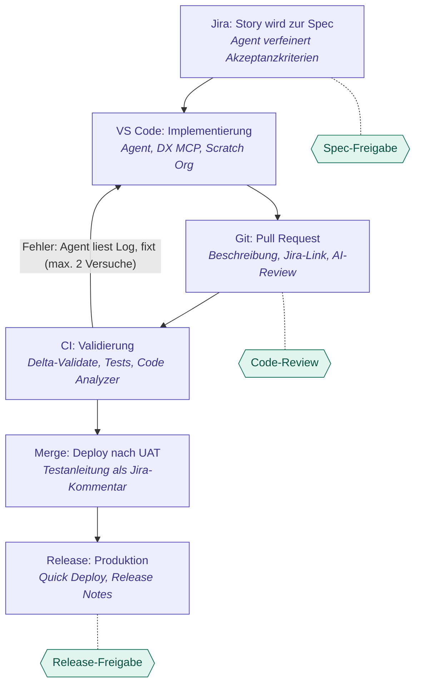

# AI-nativer Delivery-Prozess für Salesforce

Arbeitsnotiz, Stand 30.10.2026. Konzept für einen durchgängig agentengestützten Prozess von der ersten Kundenanforderung bis zum Produktiv-Deployment, mit Jira, VS Code, Git-Pipeline und Salesforce. Gedacht als Baustein zur Wiederverwendung in anderen Projekten (Kundenprojekte, Masterclass "AI im Salesforce-Ökosystem", Vorträge).

## Kernidee

AI-native statt nur AI-assisted heißt:

- Das Jira-Ticket wird zur ausführbaren Spezifikation.
- Ein Agent übernimmt die komplette Schleife von Ticket bis Pull Request.
- Die Pipeline ist der Qualitätszaun.
- Menschen sitzen an wenigen, klar definierten Toren statt an jedem Schritt.

Der rote Faden ist eine lückenlose Kette: **Aussage im Transkript → Anforderung → Story → Commit → Test → Release Note.** Jede Zeile Code lässt sich auf einen Satz zurückführen, den jemand beim Kunden gesagt hat, und umgekehrt.

---

## Teil 1: Gesamtprozess mit Kunde, Business Analyst und Entwicklung

Lila: Agent entwirft, Mensch kuratiert. Grün: gemeinsam mit dem Kunden.

### 1. Workshop vorbereiten (BA)

Bevor der Kunde im Raum ist, lässt der BA den Agenten die bestehende Org analysieren (über den Salesforce DX MCP Server: Objekte, Flows, Validierungsregeln, Berechtigungen) und vorhandene Doku in Confluence oder SharePoint lesen. Ergebnis ist eine Agenda mit Hypothesen und gezielten Fragen, z. B. "Ihr habt drei Flows auf Opportunity, die sich überschneiden – wer ist dafür fachlich zuständig?". Der Workshop startet damit auf einem anderen Niveau als mit einem leeren Whiteboard.

### 2. Discovery-Workshop mit Transkription (Kunde + BA)

Das Meeting läuft wie gewohnt, wird aber aufgezeichnet und transkribiert. Der BA moderiert und muss nicht parallel mitschreiben, was die Gesprächsqualität spürbar verbessert.

Vorher klären:

- Einwilligung aller Teilnehmenden zur Aufzeichnung (DSGVO, bei Konzernkunden oft auch Betriebsrat).
- In wessen Tenant das Transkript liegt. Bei Manufacturing-Kunden ist der Kunden-Tenant meist Pflicht; das bestimmt auch, wo der Agent arbeiten darf.

### 3. Auswertung (BA + Agent)

Aus dem Transkript erzeugt der Agent ein strukturiertes Protokoll (Entscheidungen, offene Fragen, Verantwortliche) und daraus Entwürfe für Epics und Stories in Jira, jeweils mit Zeitstempel-Verweis auf die Transkript-Stelle.

- Harte Trennung im Output zwischen "Kunde hat gesagt" und "Agent interpretiert".
- Die Rolle des BA verschiebt sich vom Schreiber zum Kurator: streichen, schärfen, Fit-Gap ergänzen (Standard vs. Konfiguration vs. Code).
- Der BA erkennt, wo das Transkript etwas Missverstandenes enthält, etwa falsch erkannte Fachbegriffe oder verwechselte Sprecher.

### 4. Protokoll bestätigen (Kunde)

Das kuratierte Protokoll geht an den Kunden zur Bestätigung. Erstes formales Tor und kommerziell wichtig, weil es die Scope-Baseline festhält.

### 5. Prototyp (Entwicklung + Agent)

Größter Unterschied zum klassischen Vorgehen: Zwischen Discovery und Refinement baut der Agent aus den Story-Entwürfen einen Prototyp in einer Scratch Org (Objekte, Felder, Layouts, ein einfacher Flow). Das kostet Stunden statt Wochen, und der Kunde reagiert im nächsten Termin auf etwas Echtes statt auf Papier.

### 6. Refinement mit Prototyp (alle)

Kunde, BA, Architekt und idealerweise ein Entwickler klicken gemeinsam durch den Prototyp. Auch dieses Meeting wird transkribiert. Der Agent erzeugt danach keinen neuen Story-Satz, sondern einen **Diff gegen die bestehenden Stories**: "Akzeptanzkriterium 3 von PROJ-42 geändert, weil Kunde bei 00:23:14 sagte …". Der BA prüft den Diff, der Architekt ergänzt technische Leitplanken, die Stories gehen auf "Ready for Agent".

### 7. Build & Pipeline (Entwicklung)

Siehe Teil 2. Zusätzlich hat der Agent über die Verweise Zugriff auf den fachlichen Kontext aus den Transkripten, wenn eine Anforderung unklar ist.

### 8. UAT mit dem Kunden (alle)

Der Agent generiert Testskripte direkt aus den Akzeptanzkriterien. UAT-Sessions und Feedback-Calls werden ebenfalls transkribiert, und der Agent klassifiziert jede Rückmeldung:

- **Bug**: widerspricht einem bestätigten Kriterium
- **Change Request**: neue Anforderung
- **Klärungsbedarf**

Für ein Beratungshaus wertvoll, weil Scope Creep sichtbar wird, mit Beleg aus dem bestätigten Protokoll statt Bauchgefühl.

### 9. Release & Doku

Release Notes für die Fix-Version und eine Anwenderhilfe in der Sprache des Fachbereichs, generiert aus Stories und Testskripten, vom BA gegengelesen.

### Was sich für die Rollen ändert

- **BA**: schreibt weniger, entscheidet mehr. Kernkompetenz wird, Widersprüche zwischen Gesagtem und Gemeintem zu erkennen.
- **Kunde**: sieht viel früher etwas Lauffähiges, braucht aber mehr Disziplin bei Bestätigungen, weil die Geschwindigkeit sonst in Chaos kippt.
- **Entwicklung**: reviewt mehr, als sie schreibt.
- **Architekt**: wird zum Hüter der Regeldatei im Repo.

### Stolpersteine im Discovery-Teil

- Transkripte sind keine Wahrheit: Ein Satz im Meeting ist keine Entscheidung. Der Agent darf daraus nie direkt verbindliche Stories ohne BA-Prüfung erzeugen.
- Kunden, die keine Aufzeichnung wollen: Der BA diktiert unmittelbar nach dem Termin eine Zusammenfassung, die denselben Weg geht.
- Aufbewahrung: Transkripte nach Abnahme löschen oder auf die bestätigten Protokolle reduzieren.

---

## Teil 2: Entwicklungs- und Deployment-Strecke

### Werkzeugkette (Stand Herbst 2026)

- **Salesforce DX MCP Server**: in Agentforce Vibes vorkonfiguriert, nutzbar direkt nach Installation der VS-Code-Extension; Agentforce Vibes 2.0 ist seit Juni 2026 GA. Der DX MCP Server lässt sich auch an Claude Code, Cursor & Co. anschließen.
- **Org-Allowlisting**: Der DX MCP Server greift nur auf explizit freigegebene Orgs zu, die beim Start festgelegt werden. Produktion nie freigeben.
- **Atlassian Rovo MCP Server**: Coding Agents können Jira lesen und schreiben und auch das Development-Panel lesen (verknüpfte Branches, PRs, Commits). Jira erlaubt, Work Items direkt an Claude, Cursor, Codex, GitHub Copilot oder den Jira Coding Agent zuzuweisen.

### Die sechs Schritte

1. **Spec in Jira**: Agent liest die Story, prüft gegen den Repo-Stand, welche Objekte, Flows und Klassen betroffen sind, schreibt Akzeptanzkriterien, Testfälle und Impact zurück ins Ticket. Architekt oder PO setzt "Ready for Agent". Wichtigstes Tor, weil Fehler hier am billigsten sind.
2. **Implementierung**: Agent legt `feature/PROJ-123` an, zieht eine Scratch Org oder Dev-Sandbox hoch, arbeitet erst im Plan-, dann im Act-Modus, schreibt Apex/LWC/Flow inklusive Tests, lässt lokal Tests und Code Analyzer laufen. Entscheidend ist eine Regeldatei im Repo (`CLAUDE.md` oder `AGENTS.md`) mit Trigger-Framework, Namenskonventionen, Sharing-Regeln und Verboten.
3. **Pull Request**: Agent schreibt PR-Beschreibung mit Ticket-Link und Komponentenliste, setzt Jira auf "In Review". AI-Reviewer kommentiert vorab, ein Mensch entscheidet.
4. **CI-Validierung**: Delta-Paket per `sfdx-git-delta`, Check-only-Deploy gegen die Integrations-Sandbox, definierte Tests, Code-Analyzer-Gate. Bei Fehlern bekommt der Agent das Log und darf einen Fix-Commit liefern, mit Obergrenze (z. B. zwei Versuche), danach zurück an einen Menschen.
5. **UAT**: Nach Merge Deploy in UAT; der Agent kommentiert im Ticket, was deployt wurde und wie der Fachbereich testen soll.
6. **Produktion**: Validierte Deployment-ID per Quick Deploy, nach menschlicher Freigabe. Release Notes generiert der Agent aus den Tickets der Fix-Version.

### Salesforce-spezifische Stolpersteine

- **Klickentwicklung**: Admins bauen Flows und Layouts weiter in Sandboxes. Der Prozess braucht einen Schritt "Agent retrieved und committet die Änderung", sonst driftet Git von der Org weg.
- **Profile, Permission Sets, Destructive Changes**: klassische Deploy-Fallen, explizite Regeln in die Agent-Datei.
- **Konfigurationsdaten** (CPQ, Field-Service-Setups, Custom Metadata vs. Custom Settings) sind kein Metadata-Deploy und brauchen eine eigene Strecke.
- **Credentials**: Produktions-Zugänge gehören ausschließlich der Pipeline, nie dem Agenten im IDE.

---

## Quellen

- [Salesforce DX MCP Server and Tools](https://developer.salesforce.com/docs/atlas.en-us.sfdx_dev.meta/sfdx_dev/sfdx_dev_mcp.htm)
- [Salesforce DX MCP Server (Org-Allowlisting)](https://developer.salesforce.com/docs/platform/sfdx-dev/guide/sfdx-dev-mcp.html)
- [Agentforce Vibes 2.0 GA](https://developer.salesforce.com/developer-centers/agentforce-vibes/announcements/agentforce-vibes-4-1-0)
- [Atlassian: MCP enhancements für Coding Agents](https://www.atlassian.com/blog/jira/mcp-enhancements)
- [Jira for AI-native software development](https://www.atlassian.com/software/jira/dev)
