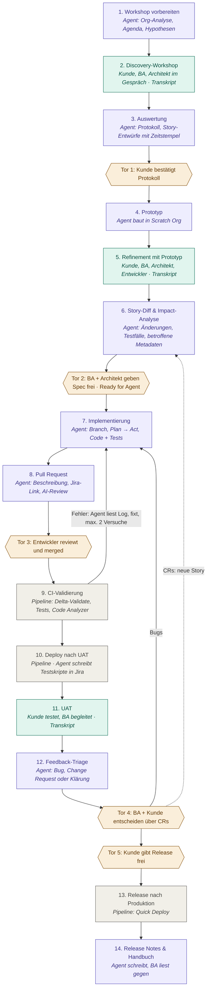

# AI-nativer Delivery-Prozess für Salesforce

Arbeitsnotiz, Stand 30.10.2026. Ein durchgängiger Prozess von der ersten Kundenanforderung bis zum Produktiv-Deployment, mit Jira, VS Code, Git-Pipeline und Salesforce. Gedacht als Baustein zur Wiederverwendung in anderen Projekten (Kundenprojekte, Masterclass "AI im Salesforce-Ökosystem", Vorträge).

## Kernidee

AI-native statt nur AI-assisted heißt:

- Das Jira-Ticket wird zur ausführbaren Spezifikation.
- Ein Agent übernimmt die Fleißarbeit von der Workshop-Vorbereitung bis zum Pull Request.
- Die Pipeline ist der deterministische Qualitätszaun, ohne KI-Entscheidungen.
- Echte Personen sitzen an klar definierten Toren und in den Gesprächen mit dem Kunden.

Der rote Faden ist eine lückenlose Kette: **Aussage im Transkript → Anforderung → Story → Commit → Test → Release Note.** Jede Zeile Code lässt sich auf einen Satz zurückführen, den jemand beim Kunden gesagt hat, und umgekehrt.

## Wer ist wer

| Akteur | Art | Rolle im Prozess |
|---|---|---|
| Kunde (Fachbereich, Key User) | Person | bringt Anforderungen ein, bestätigt, testet, gibt frei |
| Business Analyst (BA) | Person | moderiert, kuratiert Agenten-Ergebnisse, verantwortet fachliche Qualität |
| Architekt | Person | setzt technische Leitplanken, pflegt die Regeldatei im Repo, gibt Specs frei |
| Entwickler | Person | gibt Agenten-Pläne frei, reviewt Code, übernimmt bei Eskalation |
| Agent | KI | analysiert, schreibt Entwürfe, Code, Tests, Doku; entscheidet nichts Verbindliches |
| Pipeline | Automation | validiert und deployt deterministisch, keine KI |

---

## Der Prozess

Legende: **Lila** = Agent arbeitet, eine Person kuratiert. **Grün** = Gespräch mit dem Kunden, nur Personen. **Orange** = Tor, eine Person entscheidet. **Grau** = Pipeline, deterministisch.

---

## Die Schritte im Detail

Jeder Schritt trennt, was eine echte Person tut und was der Agent oder die Pipeline macht.

### 1. Workshop vorbereiten

- **Person (BA):** legt Ziel und Teilnehmende fest, schärft die vom Agenten vorgeschlagene Agenda, streicht Hypothesen, die politisch heikel sind.
- **Agent:** analysiert die bestehende Org über den Salesforce DX MCP Server (Objekte, Flows, Validierungsregeln, Berechtigungen), liest vorhandene Doku in Confluence oder SharePoint, entwirft Agenda, Hypothesen und gezielte Fragen, z. B. "Ihr habt drei Flows auf Opportunity, die sich überschneiden – wer ist dafür fachlich zuständig?".

### 2. Discovery-Workshop

- **Personen (Kunde, BA, Architekt):** das eigentliche Gespräch. Der BA moderiert und muss nicht mitschreiben. Vorab: Einwilligung aller Teilnehmenden zur Aufzeichnung (DSGVO, bei Konzernkunden oft Betriebsrat) und Klärung, in wessen Tenant das Transkript liegt.
- **Agent / Tool:** nur Aufzeichnung und Transkription (z. B. Teams). Der Agent nimmt nicht am Gespräch teil.

### 3. Auswertung

- **Agent:** erzeugt aus dem Transkript ein Protokoll (Entscheidungen, offene Fragen, Verantwortliche) und Entwürfe für Epics und Stories in Jira, jeweils mit Zeitstempel-Verweis. Trennt hart zwischen "Kunde hat gesagt" und "Agent interpretiert".
- **Person (BA):** kuratiert statt schreibt: streicht, schärft, ergänzt Fit-Gap (Standard vs. Konfiguration vs. Code), korrigiert falsch erkannte Fachbegriffe und verwechselte Sprecher.

### Tor 1: Protokoll-Freigabe

- **Person (Kunde):** bestätigt das Protokoll. Damit steht die Scope-Baseline, kommerziell wichtig für spätere Change Requests.

### 4. Prototyp

- **Agent:** baut aus den Story-Entwürfen einen Prototyp in einer Scratch Org (Objekte, Felder, Layouts, ein einfacher Flow). Stunden statt Wochen.
- **Person (Entwickler):** gibt den Rahmen vor (welche Stories, welche Org) und prüft kurz, dass der Prototyp für das Meeting vorzeigbar ist.

### 5. Refinement mit Prototyp

- **Personen (Kunde, BA, Architekt, Entwickler):** klicken gemeinsam durch den Prototyp. Der Kunde reagiert auf etwas Echtes statt auf Papier.
- **Tool:** Aufzeichnung und Transkription.

### 6. Story-Diff und Impact-Analyse

- **Agent:** erzeugt keinen neuen Story-Satz, sondern einen Diff gegen die bestehenden Stories ("Akzeptanzkriterium 3 von PROJ-42 geändert, weil Kunde bei 00:23:14 sagte …"). Ergänzt pro Story betroffene Metadaten, Testfälle und Impact gegen den Repo-Stand.
- **Person (BA):** prüft den Diff fachlich.
- **Person (Architekt):** ergänzt technische Leitplanken (Trigger-Framework, Datenmodell, Sharing).

### Tor 2: Spec-Freigabe "Ready for Agent"

- **Personen (BA + Architekt):** setzen die Story auf "Ready for Agent". Wichtigstes Tor, weil Fehler hier am billigsten sind.

### 7. Implementierung

- **Agent:** liest das Ticket über den Atlassian Rovo MCP Server, legt `feature/PROJ-123` an, zieht eine Scratch Org oder Dev-Sandbox hoch, schreibt im Plan-Modus einen Umsetzungsplan, setzt ihn im Act-Modus um (Apex, LWC, Flow inklusive Tests), lässt lokal Tests und Code Analyzer laufen. Bei unklaren Anforderungen liest er die verlinkte Transkript-Stelle, statt zu raten.
- **Person (Entwickler):** gibt den Plan frei, bevor der Agent Code schreibt, und beantwortet Rückfragen.
- **Person (Architekt):** pflegt die Regeldatei im Repo (`CLAUDE.md` oder `AGENTS.md`) mit Trigger-Framework, Namenskonventionen, Sharing-Regeln und Verboten. Sie ist der Hebel für die Qualität aller Agenten-Ergebnisse.

### 8. Pull Request

- **Agent:** schreibt die PR-Beschreibung mit Ticket-Link und Komponentenliste, setzt Jira auf "In Review". Ein AI-Reviewer kommentiert vorab.

### Tor 3: Code-Review

- **Person (Entwickler):** reviewt und merged. Der Entwickler reviewt mehr, als er schreibt.

### 9. CI-Validierung

- **Pipeline:** Delta-Paket per `sfdx-git-delta`, Check-only-Deploy gegen die Integrations-Sandbox, definierte Tests, Code-Analyzer-Gate. Rein deterministisch.
- **Agent:** bekommt bei Fehlern das Log und darf einen Fix-Commit liefern, mit Obergrenze von zwei Versuchen.
- **Person (Entwickler):** übernimmt, wenn der Agent nach zwei Versuchen nicht durchkommt.

### 10. Deploy nach UAT

- **Pipeline:** deployt nach dem Merge in die UAT-Sandbox.
- **Agent:** kommentiert im Ticket, was deployt wurde, und generiert Testskripte direkt aus den Akzeptanzkriterien.

### 11. UAT

- **Personen (Kunde, BA):** der Kunde testet, der BA begleitet Testsessions und Feedback-Calls.
- **Tool:** Aufzeichnung und Transkription der Feedback-Calls.

### 12. Feedback-Triage

- **Agent:** klassifiziert jede Rückmeldung als **Bug** (widerspricht einem bestätigten Kriterium), **Change Request** (neue Anforderung) oder **Klärungsbedarf**, jeweils mit Beleg aus dem bestätigten Protokoll.

### Tor 4: Bug- und CR-Entscheidung

- **Personen (BA + Kunde):** bestätigen die Einordnung. Bugs gehen zurück in Schritt 7, Change Requests werden als neue Story in Schritt 6 aufgenommen und kommerziell bewertet. Scope Creep wird damit sichtbar, mit Beleg statt Bauchgefühl.

### Tor 5: Release-Freigabe

- **Person (Kunde bzw. Release Manager):** gibt das Release frei.

### 13. Release nach Produktion

- **Pipeline:** rollt die validierte Deployment-ID per Quick Deploy aus. Produktions-Zugänge liegen ausschließlich bei der Pipeline, nie beim Agenten.

### 14. Release Notes und Handbuch

- **Agent:** schreibt Release Notes für die Fix-Version und eine Anwenderhilfe in der Sprache des Fachbereichs, aus Stories und Testskripten.
- **Person (BA):** liest gegen und gibt an den Kunden.

---

## Was sich für die Rollen ändert

- **BA:** schreibt weniger, entscheidet mehr. Kernkompetenz wird, Widersprüche zwischen Gesagtem und Gemeintem zu erkennen.
- **Kunde:** sieht viel früher etwas Lauffähiges, braucht aber mehr Disziplin bei Bestätigungen, weil die Geschwindigkeit sonst in Chaos kippt.
- **Entwickler:** gibt Pläne frei und reviewt, statt jede Zeile selbst zu schreiben.
- **Architekt:** wird zum Hüter der Regeldatei und damit der Qualität aller Agenten-Ergebnisse.

## Werkzeugkette (Stand Herbst 2026)

- **Salesforce DX MCP Server:** in Agentforce Vibes vorkonfiguriert, nutzbar direkt nach Installation der VS-Code-Extension; Agentforce Vibes 2.0 ist seit Juni 2026 GA. Der DX MCP Server lässt sich auch an Claude Code, Cursor & Co. anschließen.
- **Org-Allowlisting:** Der DX MCP Server greift nur auf explizit freigegebene Orgs zu, die beim Start festgelegt werden. Produktion nie freigeben.
- **Atlassian Rovo MCP Server:** Coding Agents können Jira lesen und schreiben und das Development-Panel lesen (verknüpfte Branches, PRs, Commits). Jira erlaubt, Work Items direkt an Claude, Cursor, Codex, GitHub Copilot oder den Jira Coding Agent zuzuweisen.
- **Transkription:** Teams-Aufzeichnung oder vergleichbar, im Tenant des Kunden.

## Stolpersteine

**Im Discovery-Teil**

- Transkripte sind keine Wahrheit: Ein Satz im Meeting ist keine Entscheidung. Der Agent darf daraus nie direkt verbindliche Stories ohne BA-Prüfung erzeugen.
- Kunden, die keine Aufzeichnung wollen: Der BA diktiert unmittelbar nach dem Termin eine Zusammenfassung, die denselben Weg geht.
- Aufbewahrung: Transkripte nach Abnahme löschen oder auf die bestätigten Protokolle reduzieren.

**In der Salesforce-Strecke**

- Klickentwicklung: Admins bauen Flows und Layouts weiter in Sandboxes. Der Prozess braucht einen Schritt "Agent retrieved und committet die Änderung", sonst driftet Git von der Org weg.
- Profile, Permission Sets, Destructive Changes: klassische Deploy-Fallen, explizite Regeln in die Regeldatei.
- Konfigurationsdaten (CPQ, Field-Service-Setups, Custom Metadata vs. Custom Settings) sind kein Metadata-Deploy und brauchen eine eigene Strecke.

---

## Quellen

- [Salesforce DX MCP Server and Tools](https://developer.salesforce.com/docs/atlas.en-us.sfdx_dev.meta/sfdx_dev/sfdx_dev_mcp.htm)
- [Salesforce DX MCP Server (Org-Allowlisting)](https://developer.salesforce.com/docs/platform/sfdx-dev/guide/sfdx-dev-mcp.html)
- [Agentforce Vibes 2.0 GA](https://developer.salesforce.com/developer-centers/agentforce-vibes/announcements/agentforce-vibes-4-1-0)
- [Atlassian: MCP enhancements für Coding Agents](https://www.atlassian.com/blog/jira/mcp-enhancements)
- [Jira for AI-native software development](https://www.atlassian.com/software/jira/dev)
