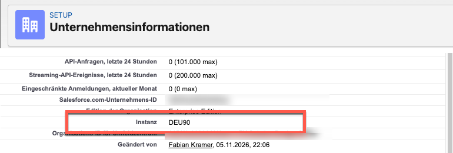
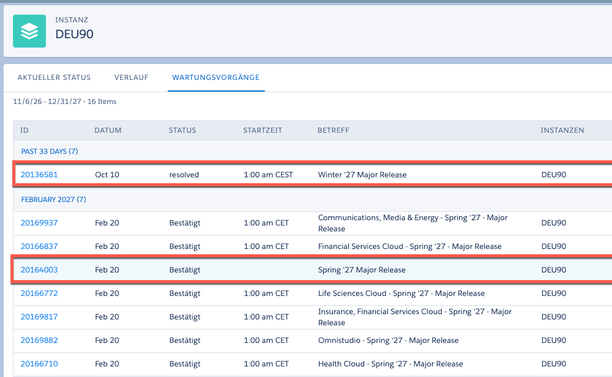

Salesforce spielt dreimal im Jahr ein großes Release ein, und den Zeitpunkt bestimmen Sie nicht selbst. Salesforce plant die Releases für Februar, Juni und Oktober, je nach Instanz beginnen die Produktions-Upgrades schon im Monat davor. Der Release Schedule gibt der IT-Leitung damit den Takt für sechs Prüfungen vor: Release Notes, Release Updates, Regressionstest in einer Preview-Sandbox, Schnittstellen und installierte Pakete, Kommunikation an den Fachbereich und eine Kontrolle nach dem Upgrade. Dieser Artikel zeigt den Ablauf am Beispiel von Winter '27, was jede Prüfung liefern sollte und welche Termine für Spring '27 jetzt zu planen sind.

## Wie läuft ein Salesforce-Release ab?

Laut [Salesforce-FAQ zum Release-Zeitplan](https://help.salesforce.com/s/articleView?id=005224913&language=en_US&type=1) erscheinen neue Funktionen dreimal im Jahr mit den Releases Spring, Summer und Winter. Salesforce legt die Upgrades in Wartungsfenster je Instanz, in der Regel zu lastarmen Zeiten und am Wochenende. Den Wartungsplan veröffentlicht Salesforce ein Jahr im Voraus.

Der Ablauf ist bei jedem Release ähnlich, Termine und Vorlaufzeiten schwanken aber. Bei Winter '27 sah er laut [Admin-Blog von Salesforce](https://admin.salesforce.com/blog/2026/admin-winter-27-release-countdown) so aus:

```zeitleiste
2026-08-13 | Anmeldung für Pre-Release-Orgs
2026-08-19 | Release Notes veröffentlicht
2026-08-27 | Stichtag für Sandbox-Refresh
2026-08-28 | Sandbox Preview beginnt
2026-09-04 | Erste Produktionsinstanzen, weitere am 2. und 9. Oktober
```

Zwischen den Release Notes und dem letzten Produktionstermin lagen also rund sieben Wochen, bei den ersten Instanzen nur gut zwei. Wer erst nach dem eigenen Produktionstermin liest, was sich ändert, hat keinen Puffer mehr.

## Mit einer Preview-Sandbox die Konfiguration für das nächste Release testen

Salesforce bietet mehrere Wege, ein Release frühzeitig kennenzulernen, die jeweils unterschiedlichen Zwecken dienen. Entscheidend ist, ob Ihre eigene Konfiguration auf dem neuen Release funktioniert.

```tabelle
titel: Drei Umgebungen rund um ein Salesforce-Release
spalten: Umgebung | Was sie enthält | Wofür sie da ist
Pre-Release-Org | Leere Developer Edition auf dem neuen Release | Neue Funktionen kennenlernen, über einen Pilot entscheiden
Preview-Sandbox | Ihre Konfiguration auf dem neuen Release, Daten je nach Sandbox-Typ | Eigene Flows, Regeln, Schnittstellen und Partnerkomponenten testen *
Sandbox auf aktuellem Release | Ihre Konfiguration auf dem Release der Produktion | Laufende Entwicklung und Hotfixes gegen den Stand der Produktion
fazit: Nur die Preview-Sandbox zeigt, wie das Release auf Ihre eigene Konfiguration wirkt. Die Pre-Release-Org eignet sich für Architekten und Produktverantwortliche.
```

Welches Release eine Sandbox erhält, hängt von ihrer Instanz ab. Laut [Hinweisen zur Sandbox Preview](https://help.salesforce.com/s/articleView?id=000391927&type=1&language=en_US) erhalten Sandboxes auf Preview-Instanzen das Upgrade vorab, bei Winter '27 am 28. und 29. August. Sandboxes auf anderen Instanzen bleiben zunächst auf dem bisherigen Release und werden zusammen mit der Produktion aktualisiert. Auch Ihre Produktionsorg liegt auf einer Instanz mit eigenem Termin, zu finden im Wartungskalender auf Salesforce Trust.

Prüfen Sie deshalb zuerst im Setup den Release Type jeder Sandbox. Oft ist gar kein Refresh nötig. Wenn doch, muss er vor dem Stichtag abgeschlossen sein, nicht nur gestartet, und er ersetzt den bisherigen Inhalt der Sandbox. Sichern Sie deshalb vorher Daten und Konfiguration, die nur dort vorhanden sind. Mindestens eine Sandbox sollte auf einer Preview-Instanz liegen. Wenn Entwicklung oder Hotfixes gegen die Produktion weitergeführt werden müssen, planen Sie eine zweite Sandbox auf dem aktuellen Release.

Wenn Partner für Sie entwickeln, gehört in die Vereinbarung, wer die Tests in der Preview-Sandbox übernimmt und bis wann Ergebnisse vorliegen. Ohne klaren Verantwortlichen und Termin bleiben Tests unvollständig oder werden von mehreren Partnern doppelt durchgeführt.

## Welche Prüfungen sollte die IT-Leitung je Release verlangen?

Jede Prüfung braucht einen Verantwortlichen, einen Termin und ein Ergebnis, das die IT-Leitung einfordern kann:

```tabelle
titel: Sechs Prüfungen je Release
spalten: Prüfung | Wann · wer | Sichtbares Ergebnis
Release Notes | Woche 1 · Architekt | Liste der Änderungen mit Wirkung auf die genutzten Produkte
Release Updates | Woche 1 bis 2 · Admin | Status und Fristen geprüft, Testläufe geplant
Regressionstest | Woche 2 bis 4 · Team und Key User | Kernprozesse in der Preview-Sandbox durchgespielt, offene Risiken bekannt *
Schnittstellen | Woche 2 bis 4 · Integration | Beide Seiten wichtiger Schnittstellen und Pakete getestet, von den Verantwortlichen bestätigt
Kommunikation | vor Produktion · Produktverantwortung | Plan für Fachbereich und Servicepartner freigegeben
Nach dem Upgrade | Produktionswochenende · Betrieb | Kurztest bestanden, Überwachung läuft, Release abgenommen
fazit: Niemand muss alle Release Notes lesen, aber jede Prüfung braucht einen Verantwortlichen und einen Termin.
```

Bei den **Release Notes** hilft ein Filter nach den Produkten, die die Org wirklich nutzt. Markieren Sie dann drei Arten von Änderungen: was Nutzer sehen, was eigene Anpassungen brechen kann und was abgeschaltet wird. Ein Beispiel für die Pipeline zeigt [Salesforce Winter '27: Was sich für Ihre Pipeline ändert](../salesforce-winter-27-aenderungen-pipeline/).

**Release Updates** im Setup zeigen Änderungen der Plattform, bei denen Sie möglicherweise handeln müssen, bevor Salesforce sie verbindlich aktiviert. Prüfen Sie den Status und die Frist, bis zu der die Schritte erledigt sein müssen, und nutzen Sie den Testlauf in einer Sandbox, wo Salesforce einen anbietet. Termine können sich verschieben, prüfen Sie sie also kurz vor dem Produktionstermin noch einmal.

Beim **Regressionstest** zählen die Prozesse, mit denen das Unternehmen Geld verdient oder Kunden bedient. Bei Herstellern sind das meist Ketten über mehrere Systeme: vom Angebot bis zum Auftrag im ERP, von der installierten Basis über den Servicefall bis zum Arbeitsauftrag, Ersatzteile mit Verfügbarkeitsprüfung und die Techniker-App, die auch offline funktionieren muss. Halten Sie die Testfälle von Release zu Release fest, damit sich der nächste Durchlauf schneller durchführen lässt. Automatisierte Tests für die wichtigsten Abläufe lohnen sich hier besonders, weil sie dreimal im Jahr für ein Release durchgeführt werden, das Sie nicht selbst entwickelt haben. Für die mobile App im Außendienst gilt ein eigener Takt, den ich in [Field Service App Updates testen](../field-service-app-updates-testen/) beschreibe.

Bei den **Schnittstellen** prüfen Sie API-Versionen, Anmeldungen, Connected Apps und installierte Pakete gemeinsam mit den Verantwortlichen der angebundenen Systeme und den Paketanbietern.

Für die **Kommunikation** reicht selten eine weitergeleitete Mail von Salesforce. Was der Fachbereich wissen muss, beschreibe ich in [Salesforce-Releases an den Fachbereich kommunizieren](../salesforce-releases-fachbereich-kommunizieren/).

## Salesforce-Releases brauchen einen eigenen Pfad in der Release-Steuerung

Die Releases von Salesforce gehören in Ihre Release-Steuerung, brauchen dort aber einen eigenen Pfad: Den Termin legt Salesforce fest, und Ihr Team kann das Upgrade der Plattform weder stoppen noch zurückrollen. In einem Kundenprogramm habe ich den Release-Prozess aufgebaut. Anfangs ging jeder Pull Request über meinen Schreibtisch. Als der Prozess stabil war, habe ich ihn an einen internen Kollegen übergeben.

Dasselbe Prinzip gilt auch für die Salesforce-Releases: Verantwortliche, Termine und Entscheidungspunkte verhindern, dass alle vier Monate kurzfristig ein Sonderfall organisiert werden muss. Tragen Sie die drei Releases als feste Termine in die Release-Planung ein. Halten Sie riskante eigene Deployments aus dem Upgrade-Wochenende und dem Test danach heraus, und halten Sie vor dem Upgrade einen Ausgangsstand fest. Dann lassen sich Änderungen vergleichen und mögliche Ursachen eingrenzen, wenn eine Funktion ausfällt. Die [DORA-Metriken für Salesforce](../dora-metriken-salesforce-releases/) helfen, Durchsatz und Instabilität der eigenen Auslieferung über die Zeit zu messen. Wie ich Release-Prozesse mit Kunden aufbaue, steht unter [DevOps und Release-Management](../../leistungen/devops-und-release-management/).

## Spring '27: Preview am 8. Januar, Produktion ab 16. Januar

Stand 6. November 2026 nennt der [Sandbox Preview Guide von Salesforce](https://sandbox-preview-prd-24f76e67b11e.herokuapp.com/) den 8. Januar 2027 als Start der Preview für Spring '27. Der [Wartungskalender auf Trust](https://status.salesforce.com/) nennt drei Produktionswochenenden.

```zeitleiste
2027-01-08 | Sandbox Preview beginnt
2027-01-16 | Erste Produktionsinstanzen
2027-02-06 | Zweites Produktionswochenende
2027-02-20 | Drittes Produktionswochenende
```

Die erste Welle muss am frühesten vorbereitet werden: Orgs mit Upgrade am 16. Januar haben zwischen dem Start der Preview und der Produktion nur acht Tage, und diese fallen direkt in die Zeit nach den Weihnachtsferien. Den Termin der Release Notes und den Stichtag für den Sandbox-Refresh hat Salesforce noch nicht angekündigt.

Welches der drei Wochenenden für Ihre Org gilt, finden Sie in zwei Schritten heraus. Zuerst finden Sie die Instanz im Setup unter Unternehmensinformationen:



Dann öffnen Sie diese Instanz auf [Salesforce Trust](https://status.salesforce.com/) und wechseln auf den Reiter Wartungsvorgänge. Dort ist jedes große Release mit Datum aufgeführt:



Im Beispiel liegt die Org auf DEU90 in der letzten Welle und erhält Spring '27 am 20. Februar. Für die Release-Planung zählt dieser Termin, nicht das erste Produktionswochenende.

## Den Sandbox-Plan für Spring '27 im Dezember festlegen

Prüfen Sie zuerst im Setup, auf welcher Instanz Ihre Produktion liegt, und auf Trust, wann diese Instanz das Upgrade erhält. Dann wissen Sie, ob Sie zur Januar-Welle gehören. Legen Sie dann im Dezember fest, welche Sandbox auf die Preview für Spring '27 wechselt und welche auf dem aktuellen Release bleibt. Prüfen Sie den Release Type jeder Sandbox im Setup, bestätigen Sie im Sandbox Preview Guide die empfohlene Aktion für ihre Instanz und planen Sie einen Refresh nur dort, wo er nötig ist. Benennen Sie für jede der sechs Prüfungen einen Verantwortlichen und tragen Sie die Termine in den Kalender des Teams ein, sobald Salesforce die Release Notes ankündigt.
